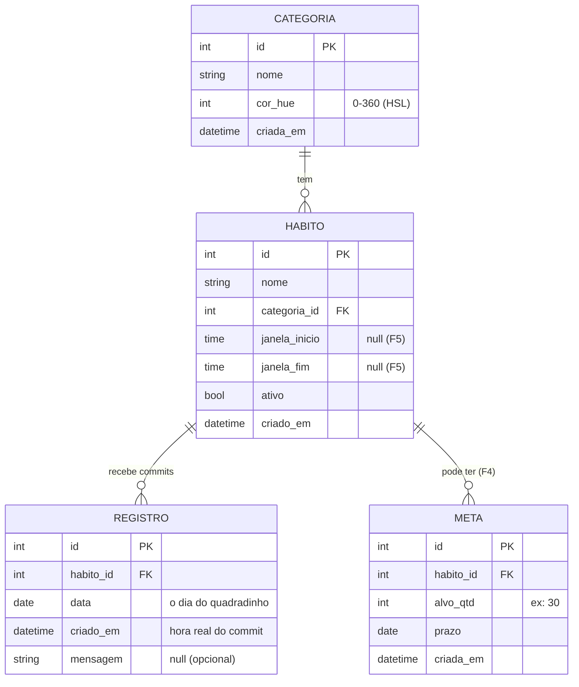
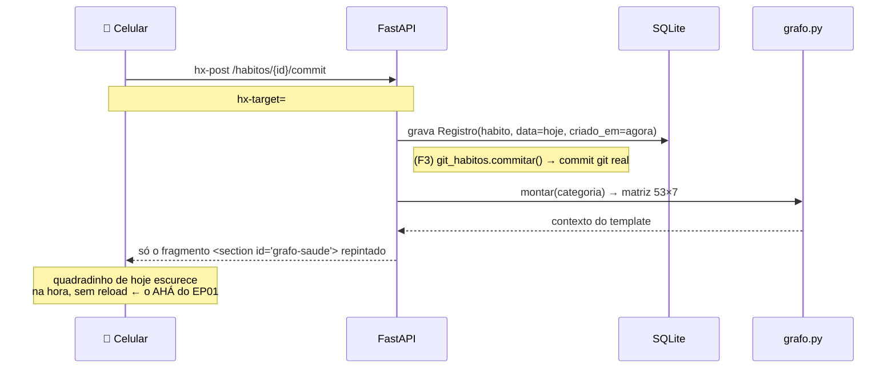
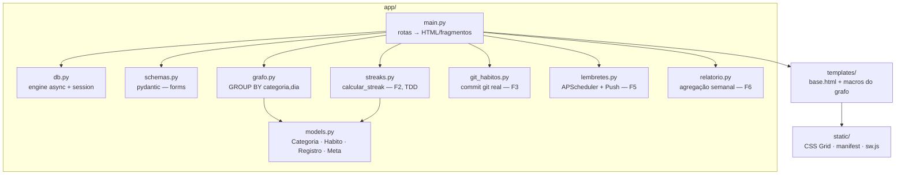
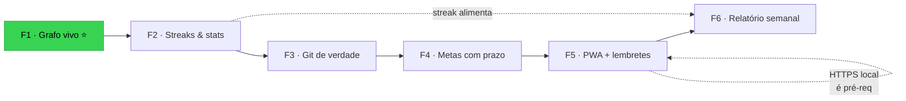
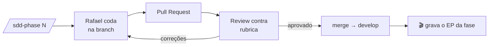

# HabitHub 🟩

> App de hábitos com a **estética do contribution graph do GitHub**: cada categoria de hábito tem uma cor, cada hábito cumprido é um **"commit"**, e o grafo do ano vai pintando. Feedback visual acumulado (o vício dos quadradinhos) **sem sistema de punição** — a única consequência de falhar é o quadradinho vazio e a streak zerada.

Roda como **PWA mobile-first** servido na rede local: o hábito se marca no celular, o grafo pinta na hora.

   

---

## 🎯 Por que existe

Cumprir hábitos depende de motivação — e motivação acaba. O que funciona é **feedback visual acumulado** (não deixar buraco no desenho), não cobrança. Os apps prontos ou são genéricos demais, ou **gamificam/punem demais** (Habitica) — e o app acaba abandonado em duas semanas. O HabitHub é o meio-termo:

- **Minimalista e honesto:** quem fala é o grafo.
- **Sem punição** (é arquitetural, não só de UX): falhar é só o quadradinho vazio. Não existe "vida", dano ou estado negativo no modelo de dados.
- **Cada canto da vida com sua cor:** academia verde, leitura azul — um contribution graph por categoria, empilhados.
- **"Commit" de verdade:** na Fase 3, cada hábito marcado vira um **commit git real** — o `git log` vira um diário auditável (e dá pra espelhar no GitHub e pintar o grafo de lá).

> Uso pessoal + portfólio + série de conteúdo *build-in-public*. Não é produto (por ora). É também um projeto de **prática de Python**.

---

## ✨ Features (por fase)

| # | Feature | O que entrega |
|---|---------|---------------|
| 1 | **Grafo vivo** ⭐ | CRUD de hábitos/categorias (cada categoria com cor) + "commit" na UI + um contribution graph por categoria; marcar o hábito **pinta o quadradinho na hora** (HTMX, sem reload) |
| 2 | **Streaks & stats** | Sequência atual + recorde (por hábito e geral) + taxa de conclusão por categoria — sem punição, o grafo fala |
| 3 | **Git de verdade** | Cada "commit" da UI gera um **commit git real** num repo local de hábitos; `git log` = diário auditável (espelhável no GitHub) |
| 4 | **Metas com prazo** | Metas ligadas aos commits + barra de progresso ("30 treinos até setembro: 12/30") |
| 5 | **PWA + lembretes** | Instalável no celular, janelas de horário por hábito + **Web Push** quando a janela abre/fecha |
| 6 | **Relatório semanal** | Resumo automático da semana (cumpriu / falhou / onde falha mais) — insumo do ritual de domingo |

### O que o HabitHub **não** é (Non-Goals)

- ❌ **Não é gamificado nem punitivo** — sem vidas, gacha, HARDCORE, badges, níveis ou pontos. A única mecânica é a streak e o grafo.
- ❌ **Sem loja** (Play/App Store) — é **PWA na rede local** ("sem loja, sem taxa" é parte da promessa).
- ❌ **Sem multiusuário / conta / nuvem** — uso pessoal, roda local.
- ❌ **Sem social / feed / comparação** — o grafo é seu, ponto.

---

## 🧱 Stack

Python-first, server-rendered, mínimo de JavaScript.

| Camada | Escolha | Por quê |
|--------|---------|---------|
| Backend | **FastAPI** + **Uvicorn** | rotas + DI, retorna HTML |
| ORM / DB | **SQLAlchemy async** + **aiosqlite** + **SQLite** | um arquivo, zero setup de servidor |
| Templates | **Jinja2** | herança + macros do grafo |
| Interação | **HTMX** | `hx-post`/`hx-target`/`hx-swap` repintam fragmentos sem reload — sem SPA |
| Grafo | **CSS Grid puro** | 53×7 quadradinhos, sem lib de chart |
| Validação | **Pydantic v2** | schemas dos forms |
| Git real (F3) | **git CLI via subprocess** | "Python cola ferramenta externa" (mesmo padrão dos projetos irmãos) |
| Lembretes (F5) | **APScheduler** + **pywebpush** | jobs de janela de horário + Web Push |
| PWA (F5) | manifest + service worker + **mkcert/caddy** | HTTPS na rede local (pré-req de SW e Push) |

> **Um venv só** (sem torch → sem venv duplo, ADR-008).

---

## 🏗️ Arquitetura

### Modelo de dados



- **`REGISTRO` é o "commit".** Chama-se "commit" na UI e no conteúdo, mas o model é `Registro` — evita colisão com git e com `session.commit()` do SQLAlchemy (ADR-004).
- **O grafo é um `GROUP BY (categoria, data) → COUNT`.** Não existe tabela de "dia": dia vazio = sem `Registro` = quadradinho vazio (a "falha" sem punição).
- **Streak é derivado, nunca persistido** (ADR-003) — calculado a partir da lista de datas dos `Registro`. Fonte única de verdade, zero risco de dessincronizar.

### Fluxo do "commit" (F1 — o coração)



### Módulos



> ⚠️ A estrutura acima é o **alvo**, não código pronto. Ver [ADRs](#-decisões-de-arquitetura-adrs).

---

## 🗺️ Roadmap



**Marcos:**
- **Fim da F1** → marcar um hábito **pinta o quadradinho na hora** (demo já no primeiro EP).
- **Fim da F3** → o `git log` da vida real pinta o grafo do GitHub ("enganei o site dos programadores: meu perfil é de flexão e livro").
- **Fim da F6** → o relatório de domingo se gera sozinho.

Cada fase = 1 arco fechado = 1 episódio da série *build-in-public*.

---

## 🚀 Setup (F1)

> Requer Python 3.14 do sistema. ⚠️ Se algum wheel (pydantic v2 é o candidato) ainda não existir pro 3.14, criar o venv com 3.12/3.13 — é um venv só, sem custo.

```bash
git clone <este-repo> ~/dev/habithub
cd ~/dev/habithub

python -m venv .venv && source .venv/bin/activate
pip install -r requirements.txt

# baixar htmx.min.js pra static/ (HTMX não é pip)

uvicorn app.main:app --reload   # http://127.0.0.1:8000
```

### Servir na rede local (marcar no celular)

```bash
# F1–F4 (HTTP):
uvicorn app.main:app --host 0.0.0.0 --port 8000
# descobrir o IP com `ip addr` → acessar http://192.168.x.x:8000 no celular

# F5 (HTTPS — obrigatório pro PWA/Web Push):
mkcert -install
mkcert 192.168.x.x localhost      # gera cert local confiável
# caddy faz reverse proxy TLS → https://192.168.x.x
```

---

## 🧭 Decisões de arquitetura (ADRs)

| ADR | Decisão | Resumo |
|-----|---------|--------|
| **001** ⭐ | Server-rendered (Jinja2 + HTMX), JS mínimo | HTMX troca fragmentos de HTML; nada de SPA/bundler |
| **002** ⭐ | Grafo = **um por categoria**, empilhados (CSS Grid) | "cada canto da vida com sua cor"; leitura imediata; `GROUP BY` simples |
| **003** | Streak é **derivado**, não persistido | `calcular_streak(datas)`; fonte única = histórico de `Registro` |
| **004** | "Commit" (domínio) = model `Registro` (código) | evita colisão com git e `session.commit()` |
| **005** | Git real via **subprocess** (git CLI), não GitPython | `GIT_AUTHOR_DATE`/`GIT_COMMITTER_DATE` fixam a data retroativa |
| **006** ⭐ | **Sem punição é arquitetural** | nenhuma penalidade no modelo; falha = ausência de `Registro` |
| **007** | PWA na rede local exige **HTTPS** (F5) | SW e Web Push só em contexto seguro → mkcert/caddy |
| **008** | Roda no **Python do sistema** (sem venv duplo) | sem torch/IA → um venv só |

---

## 🔀 Fluxo de trabalho

Projeto de prática de Python em **modo tutor-review** (SDD + GitHub Flow):



- Branch de trabalho: **`develop`**.
- Cada fase fechada → DoD completa + vídeo da fase.
- Commits **sem** trailer de co-autoria.

---

## 📁 Estrutura do repositório

```
habithub/
├── app/                 # código do app (a escrever nas fases)
│   ├── main.py          # FastAPI + rotas
│   ├── db.py            # engine/session async
│   ├── models.py        # Categoria · Habito · Registro · Meta
│   ├── schemas.py       # pydantic
│   ├── grafo.py         # agregação por (categoria, dia)
│   ├── streaks.py       # calcular_streak (F2)
│   ├── git_habitos.py   # commit git real (F3)
│   ├── lembretes.py     # APScheduler + Web Push (F5)
│   └── relatorio.py     # agregação semanal (F6)
├── templates/           # base.html + macros do grafo (Jinja)
├── static/              # CSS (Grid do grafo), manifest.json, sw.js (F5)
├── tests/               # pytest (calcular_streak primeiro — F2)
├── requirements.txt
├── .gitignore
└── README.md
```

> O repo de **histórico de hábitos** (F3) é **separado** — nunca aninhado neste repo.

---

## 📄 Licença

Uso pessoal. Sem licença aberta por ora.
