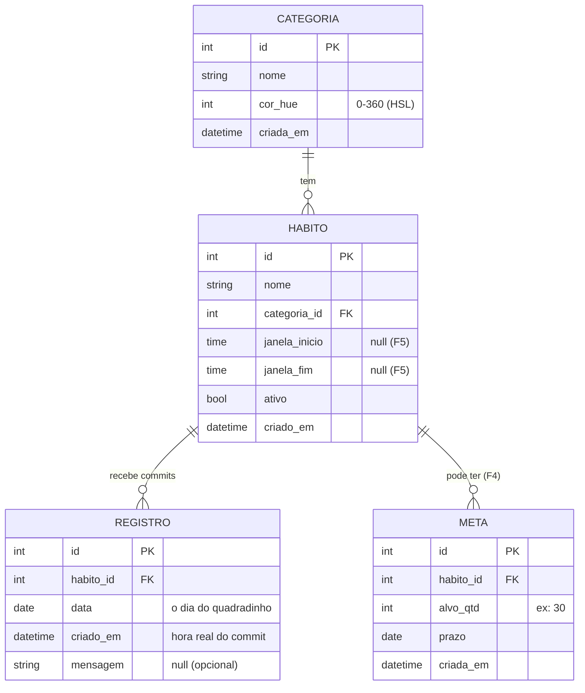
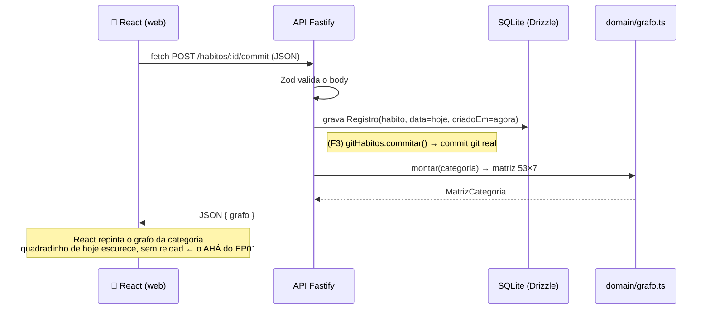
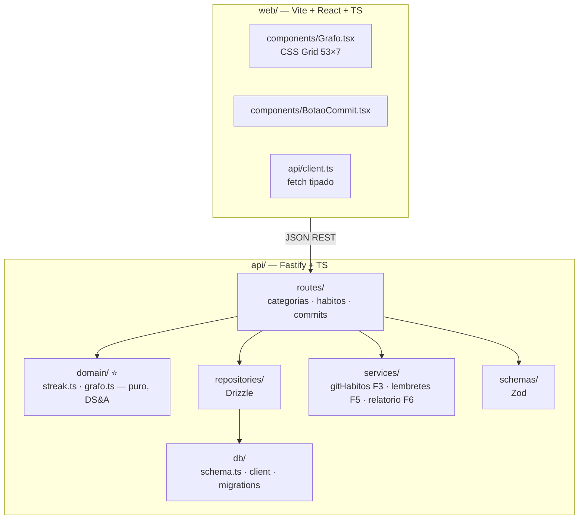
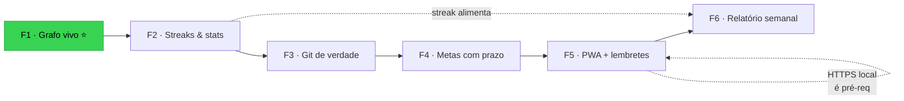
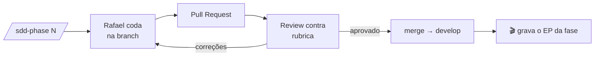

# HabitHub 🟩

> App de hábitos com a **estética do contribution graph do GitHub**: cada categoria de hábito tem uma cor, cada hábito cumprido é um **"commit"**, e o grafo do ano vai pintando. Feedback visual acumulado (o vício dos quadradinhos) **sem sistema de punição** — a única consequência de falhar é o quadradinho vazio e a streak zerada.

Roda como **PWA mobile-first** servido na rede local: o hábito se marca no celular, o grafo pinta na hora.

   

---

## 🎯 Por que existe

Cumprir hábitos depende de motivação — e motivação acaba. O que funciona é **feedback visual acumulado** (não deixar buraco no desenho), não cobrança. Os apps prontos ou são genéricos demais, ou **gamificam/punem demais** (Habitica) — e o app acaba abandonado em duas semanas. O HabitHub é o meio-termo:

- **Minimalista e honesto:** quem fala é o grafo.
- **Sem punição** (é arquitetural, não só de UX): falhar é só o quadradinho vazio. Não existe "vida", dano ou estado negativo no modelo de dados.
- **Cada canto da vida com sua cor:** academia verde, leitura azul — um contribution graph por categoria, empilhados.
- **"Commit" de verdade:** na Fase 3, cada hábito marcado vira um **commit git real** — o `git log` vira um diário auditável (e dá pra espelhar no GitHub e pintar o grafo de lá).

> Uso pessoal + portfólio + série de conteúdo *build-in-public*. Não é produto (por ora). É também um projeto de **prática de Python**.

---

## ✨ Features (por fase)

| # | Feature | O que entrega |
|---|---------|---------------|
| 1 | **Grafo vivo** ⭐ | CRUD de hábitos/categorias (cada categoria com cor) + "commit" na UI + um contribution graph por categoria; marcar o hábito **pinta o quadradinho na hora** (HTMX, sem reload) |
| 2 | **Streaks & stats** | Sequência atual + recorde (por hábito e geral) + taxa de conclusão por categoria — sem punição, o grafo fala |
| 3 | **Git de verdade** | Cada "commit" da UI gera um **commit git real** num repo local de hábitos; `git log` = diário auditável (espelhável no GitHub) |
| 4 | **Metas com prazo** | Metas ligadas aos commits + barra de progresso ("30 treinos até setembro: 12/30") |
| 5 | **PWA + lembretes** | Instalável no celular, janelas de horário por hábito + **Web Push** quando a janela abre/fecha |
| 6 | **Relatório semanal** | Resumo automático da semana (cumpriu / falhou / onde falha mais) — insumo do ritual de domingo |

### O que o HabitHub **não** é (Non-Goals)

- ❌ **Não é gamificado nem punitivo** — sem vidas, gacha, HARDCORE, badges, níveis ou pontos. A única mecânica é a streak e o grafo.
- ❌ **Sem loja** (Play/App Store) — é **PWA na rede local** ("sem loja, sem taxa" é parte da promessa).
- ❌ **Sem multiusuário / conta / nuvem** — uso pessoal, roda local.
- ❌ **Sem social / feed / comparação** — o grafo é seu, ponto.

---

## 🧱 Stack

**JS/TS** — SPA React + API REST Node separadas (re-arquitetado 2026-08-15, era Python-first).

| Camada | Escolha | Por quê |
|--------|---------|---------|
| Frontend | **Vite** + **React 19** + **TypeScript** | SPA; espelha o setup do Grimório |
| Backend | **Fastify** + **TypeScript** (`tsx`) | API REST Node, rotas + hooks |
| ORM / DB | **Drizzle ORM** + **better-sqlite3** + **SQLite** | TS-first, SQL-próximo, um arquivo |
| Validação | **Zod** | schemas de body/params → DTO tipado |
| Grafo | **CSS Grid puro** | 53×7 quadradinhos, sem lib de chart |
| Testes | **Vitest** | domínio puro (streak, agregação do grafo) |
| Git real (F3) | **`node:child_process`** (git CLI) | commit real com data retroativa |
| Lembretes (F5) | **node-cron** + **web-push** | jobs de janela de horário + Web Push |
| PWA (F5) | **vite-plugin-pwa** + **mkcert/caddy** | HTTPS na rede local (pré-req de SW e Push) |

> **Dois `package.json`** (`api/`, `web/`), sem tooling de monorepo (ADR-008). Domínio puro isolado em `api/src/domain/` (ADR-009) — testável e campo de treino de DS&A.

---

## 🏗️ Arquitetura

### Modelo de dados



- **`REGISTRO` é o "commit".** Chama-se "commit" na UI e no conteúdo, mas o model é `Registro` — evita colisão com git e com `session.commit()` do SQLAlchemy (ADR-004).
- **O grafo é um `GROUP BY (categoria, data) → COUNT`.** Não existe tabela de "dia": dia vazio = sem `Registro` = quadradinho vazio (a "falha" sem punição).
- **Streak é derivado, nunca persistido** (ADR-003) — calculado a partir da lista de datas dos `Registro`. Fonte única de verdade, zero risco de dessincronizar.

### Fluxo do "commit" (F1 — o coração)



### Módulos



> ⚠️ A estrutura acima é o **alvo**, não código pronto. Ver [ADRs](#-decisões-de-arquitetura-adrs).

---

## 🗺️ Roadmap



**Marcos:**
- **Fim da F1** → marcar um hábito **pinta o quadradinho na hora** (demo já no primeiro EP).
- **Fim da F3** → o `git log` da vida real pinta o grafo do GitHub ("enganei o site dos programadores: meu perfil é de flexão e livro").
- **Fim da F6** → o relatório de domingo se gera sozinho.

Cada fase = 1 arco fechado = 1 episódio da série *build-in-public*.

---

## 🚀 Setup (F1)

> Requer Node.js LTS (≥ 20). Dois pacotes: `api/` (Fastify) e `web/` (Vite+React). O código do app é do Rafael (modo tutor-review).

```bash
git clone <este-repo> ~/dev/habithub
cd ~/dev/habithub
npm run setup      # instala api/ e web/
```

### 📦 Comandos (todos da raiz — não precisa entrar nas pastas)

O `package.json` da raiz é um **orquestrador**: não tem dependência nenhuma e delega pros dois pacotes com `npm --prefix`. **Não usa workspaces** — `api/` e `web/` continuam independentes (ADR-008).

| Comando | O que faz |
|---|---|
| `npm start` / `npm run tui` | abre a **TUI** (tudo em um lugar) |
| `npm run dev` | sobe API + Web no **painel split** |
| `npm run dev:api` · `npm run dev:web` | sobe um só, saída crua |
| `npm test` · `test:watch` · `test:coverage` | Vitest na `api/` |
| `npm run typecheck` | `tsc` nos **dois** pacotes |
| `npm run lint` | oxlint no `web/` |
| **`npm run verify`** | typecheck + lint + testes — **o gate do PR** |
| `npm run db:generate` · `db:migrate` · `db:studio` | Drizzle |
| `npm run seed` · `seed:demo` | popula o banco |
| `npm run build` | build de produção do `web/` |
| `npm run check` | diagnóstico do projeto, sem abrir a TUI |

<details>
<summary>Como os pacotes foram criados (histórico)</summary>

```bash
# --- API (Fastify + TS + Drizzle) ---
mkdir api && cd api && npm init -y
npm i fastify @fastify/cors drizzle-orm better-sqlite3 zod
npm i -D typescript tsx drizzle-kit @types/better-sqlite3 @types/node vitest
npm i -D pino-pretty @vitest/coverage-v8
cd ..

# --- WEB (Vite + React + TS) — igual ao Grimório ---
npm create vite@latest web -- --template react-ts
cd web && npm i && cd ..
```
</details>

### 🎛️ A TUI — todo comando mora aqui

```bash
./scripts/habithub
```

CLI gráfica que centraliza o projeto: sobe **API e Web em painéis lado a lado** com os logs separados, roda testes (todos, um arquivo específico, watch), mostra **coverage total ou por arquivo com as linhas descobertas**, e cuida de migrations, seed e typecheck/lint. Zero dependências — só Node. Detalhes em [`scripts/README.md`](scripts/README.md).

`./scripts/habithub --check` mostra o estado do projeto sem abrir a interface.

### Servir na rede local (marcar no celular)

```bash
# F1–F4 (HTTP): API em host 0.0.0.0 (:3000) + Vite --host (:5173, proxy /api → :3000)
#   descobrir o IP com `ip addr` → acessar http://192.168.x.x:5173 no celular

# F5 (HTTPS — obrigatório pro PWA/Web Push):
mkcert -install
mkcert 192.168.x.x localhost      # gera cert local confiável
# caddy faz reverse proxy TLS → https://192.168.x.x
```

---

## 🧭 Decisões de arquitetura (ADRs)

| ADR | Decisão | Resumo |
|-----|---------|--------|
| **001** ⭐ | **SPA React (Vite) + API REST Node (Fastify)** *(revertido 15/08)* | era server-rendered; agora front/back separados por JSON — ensaia o padrão da Nyx |
| **002** ⭐ | Grafo = **um por categoria**, empilhados (CSS Grid) | "cada canto da vida com sua cor"; leitura imediata; `GROUP BY` simples |
| **003** | Streak é **derivado**, não persistido | `calcularStreak(datas)`; fonte única = histórico de `registros` |
| **004** | "Commit" (domínio) = tabela/tipo `Registro` (código) | evita colisão com git |
| **005** | Git real via **`child_process`** (git CLI) | `GIT_AUTHOR_DATE`/`GIT_COMMITTER_DATE` fixam a data retroativa |
| **006** ⭐ | **Sem punição é arquitetural** | nenhuma penalidade no modelo; falha = ausência de `registro` |
| **007** | PWA na rede local exige **HTTPS** (F5) | SW e Web Push só em contexto seguro → mkcert/caddy |
| **008** | Repo **`web/` + `api/` separados**, sem monorepo | dois `package.json`; evita overhead que pioraria o Problema B |
| **009** | **Domínio puro isolado** (`api/src/domain/`) | streak/grafo sem framework → testável (Vitest) + campo de DS&A |

---

## 🔀 Fluxo de trabalho

Projeto de prática de **JS/TS/Node** em **modo tutor-review** (SDD + GitHub Flow):



- Branch de trabalho: **`develop`**.
- Cada fase fechada → DoD completa + vídeo da fase.
- Commits **sem** trailer de co-autoria.

---

## 📁 Estrutura do repositório

```
habithub/
├── api/                     # Backend — Fastify + TypeScript
│   ├── src/
│   │   ├── server.ts        # bootstrap Fastify (CORS, rotas, errors)
│   │   ├── routes/          # categorias · habitos · commits
│   │   ├── domain/ ⭐        # streak.ts · grafo.ts — puro, testável, DS&A
│   │   ├── repositories/    # acesso a dados (Drizzle)
│   │   ├── services/        # gitHabitos (F3) · lembretes (F5) · relatorio (F6)
│   │   ├── schemas/         # Zod
│   │   └── db/              # schema.ts · client · migrations
│   ├── package.json
│   └── tsconfig.json
├── web/                     # Frontend — Vite + React + TS
│   ├── src/
│   │   ├── components/      # Grafo.tsx (CSS Grid) · BotaoCommit.tsx · Form*.tsx
│   │   ├── api/client.ts    # fetch tipado
│   │   └── styles/
│   └── package.json
├── bruno/                   # Collection Bruno — exploração da API (.bru versionado)
│   ├── environments/        # Local · LAN (celular)
│   └── Health/ Categories/ Habits/ Commits/ Erros/ Limpeza/
├── .gitignore
└── README.md
```

> O repo de **histórico de hábitos** (F3) é **separado** — nunca aninhado neste repo.

---

## 📄 Licença

Uso pessoal. Sem licença aberta por ora.
