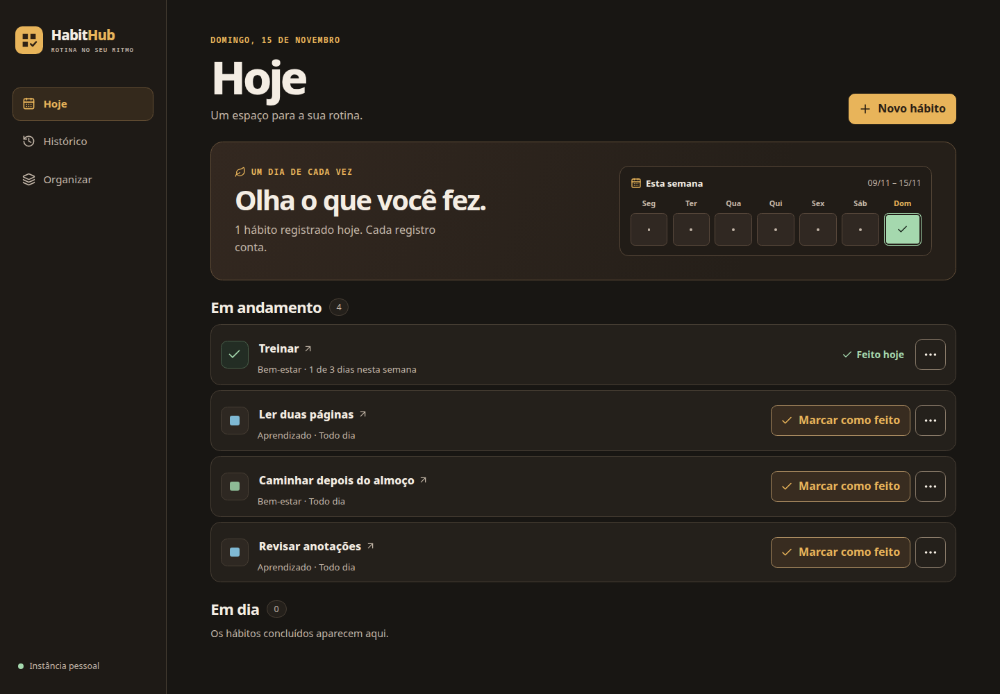
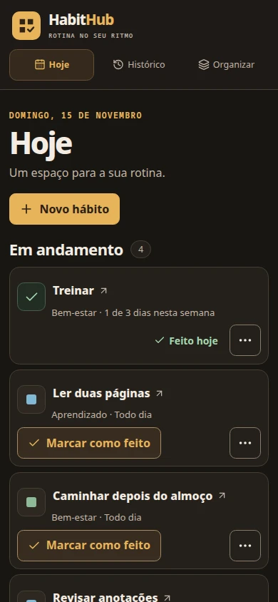

<p align="center">
  
</p>

# HabitHub

**Track your habits and see your progress, one square at a time.** HabitHub is a personal habit tracker that runs on your own computer or server. Check in from a desktop or mobile browser, see when you followed through, and keep your history in a local SQLite database. The app is in Brazilian Portuguese and requires no account.

[Install](#install) · [Your first habit](#your-first-habit) · [Screenshots](#screenshots) · [Backups and remote access](#backups-and-remote-access)

## What you can do

- **Plan around your week.** Set habits you want to do daily or pick a weekly target such as three workouts. Choose the days as you go.
- **Check in with one click.** Mark a habit as done, undo a mistake, or add a past check-in with an optional note.
- **See the days you showed up.** Open a monthly calendar for a specific habit or use the annual heatmap to see activity across a category.
- **Keep a record when your routine changes.** Archive and restore habits without losing their history, and export your data as JSON.

## Install

Install Git and [Docker with Compose](https://docs.docker.com/compose/install/) before running these commands.

```sh
git clone https://github.com/rfsants001/habithub.git
cd habithub
docker compose up -d --build
```

Open [http://localhost:8080](http://localhost:8080) on the same machine. The first build may take a few minutes. Compose stores your data in the `habits` volume, and HabitHub applies database migrations at startup.

## Your first habit

1. On **Hoje** (Today), select **Novo hábito** (New habit). Give it a name and choose or create a category.
2. Pick **Todo dia** (Every day) or **Alguns dias por semana** (Some days per week). Weekly goals count distinct days from Monday to Sunday.
3. After doing the habit, select **Marcar como feito** (Mark as done). Use **Desfazer** (Undo) if you clicked by mistake. For a past date, open the habit’s options and choose **Registrar em outra data** (Log another date).
4. Open **Histórico** (History) to find the days you checked in. Select a habit for its monthly calendar or a category for its annual heatmap.

Use **Organizar** (Organize) to manage categories, restore archived habits, or download a backup.

## Screenshots



<details>
  <summary>See HabitHub on a phone</summary>
  <br />
  
</details>

## Backups and remote access

| Task | How to do it |
| --- | --- |
| Back up your history | Go to **Organizar → Backup → Baixar backup** to download a JSON file. |
| Restore a backup | Use the restore command in the [self-hosting guide](docs/self-hosting.md#fazer-backup-e-restaurar) with a fresh database. |
| Access it from your phone | Put the whole app behind a private VPN or an authenticated HTTPS reverse proxy. The default setup listens on `127.0.0.1` and serves one person per instance. |
| Change the port or time zone | Set `HABITHUB_PORT` or `TZ` in `.env`. The default port is `8080` and the default time zone is `America/Sao_Paulo`. |
| Update HabitHub | Download a backup, run `git pull --ff-only` in your checkout, then run `docker compose up -d --build` again. |

For details on remote access, database migration and recovery, see the [self-hosting guide in Portuguese](docs/self-hosting.md).

## Develop locally

Use Node.js 24 and npm. `better-sqlite3` may need Python and C/C++ build tools on platforms without a prebuilt binary.

```sh
npm run setup
npm run dev
```

Open [http://localhost:5173](http://localhost:5173). `npm run dev` starts the API and the web app in one terminal. Press Ctrl+C to stop both. Run `npm run setup` after pulling changes to either lockfile.

Use `npm run dev:api` or `npm run dev:web` to run a single service. Set `PORT` for the API or `WEB_PORT` for the web app if the defaults (`3000` and `5173`) are in use. The API uses `api/habithub.db` by default.

Run `npm run verify` and `npm run build` to check your changes. `npm run tui` opens the optional interactive control panel.

The UI uses React, TypeScript and [Lucide](https://lucide.dev/). The API uses Fastify and SQLite. See the [product notes](docs/product.md) and [accessibility checklist](docs/accessibility.md) for more on the design and roadmap.
